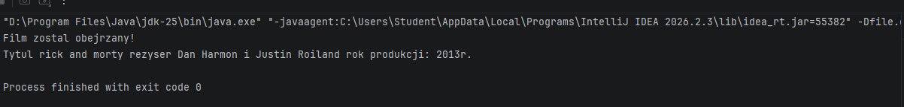
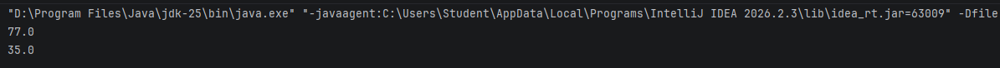
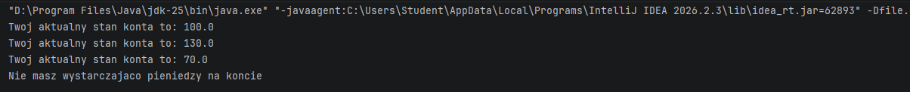
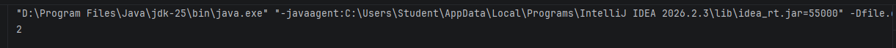
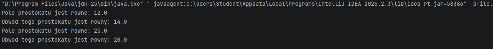

## I. Dokumentacja do lab. nr 2 - "Klasy i metody"
## II. Olivier Starostka - grupa 4, semestr III
## III. Przedmiot - "Programowanie obiektowe"

## IV. Opis zadania do realizacji
Do zrealizowania były następujące zadania:  
  - Napisz klasę Film z polami tytul, rezyser, rokProdukcji, obejrzany oraz metodami obejrzyj(), wyswietlInfo() lub toString() (zalecane). Utwórz dwa obiekty danej klasy i ustaw wybrane przez siebie wartości pól oraz wyświetl informacje za pomocą zdefiniowanych metod,  
  - Utwórz klasę KalkulatorTemperatur z metodami statycznymi celsiusToFahrenheit(double) i fahrenheitToCelsius(double),  
  - Zaimplementuj klasę BankAccount z metodami deposit(double), withdraw(double) i getBalance() oraz podstawową walidacją,
    Napisz klasę StudentGroup, która posiada pole statyczne zliczające liczbę utworzonych obiektów klasy Student,
    Przygotuj klasę Rectangle z konstruktorem, polami width i height oraz metodami area() i perimeter() wykorzystującymi this,
    Dodaj do jednej wybranej klasy metodę z varargs (np. sum(int... numbers)) i pokaż jej użycie dla różnych liczb argumentów. Poniżej przykład z varargs.  

## V. Technologie wykorzystane w zadaniu
  - Java

## VI. Realizacja zadania
<br>

#### Zad. 1
W zadaniu wykorzystano .... (krótko opisać, co zostało użyte).

Kod wykorzystany do rozwiązania zadania (zadań):  

```java
public class Film {
    String tytul;
    String rezyser;
    int rokProdukcji;
    boolean obejrzany;

    void obejrzyj(){
        obejrzany = true;
        System.out.println("Film zostal obejrzany!");
    }

    String wyswietlInfo(){
        return "Tytul " + tytul + " rezyser " + rezyser + " rok produkcji: " + rokProdukcji + "r.";
    }

    public static void main(String[] args) {
        Film film = new Film();
        film.tytul = "rick and morty";
        film.rezyser = "Dan Harmon i Justin Roiland";
        film.rokProdukcji = 2013;
        film.obejrzyj();
        System.out.println(film.wyswietlInfo());
    }
}
```

#### Zad. 2
```java
public class KalkulatorTemperatur {
    static double cTemp, fTemp;
    public static void celsiusToFahrenheit(double x){
        fTemp = (x*9/5)+32;
        System.out.println(fTemp);
    }

    public static void fahrenheitToCelsius(double x){
        cTemp = (x-32)*5/9;
        System.out.println(cTemp);
    }

    static void main(String[] args) {
        KalkulatorTemperatur t = new KalkulatorTemperatur();
        cTemp = 25;
        celsiusToFahrenheit(cTemp);
        fTemp = 95;
        fahrenheitToCelsius(fTemp);
    }
}
```

#### Zad. 3
```java
public class BankAccount {
    double balance;
    public void deposit(double newMoney){
        if(newMoney>0)  {
            balance = balance + newMoney;
            System.out.println("Twoj aktualny stan konta to: "+balance);
        }
        else {
            System.out.println("Liczba wplaty jest za niska");
        }
    }

    public void withdraw(double x){
        if(x<=balance){
            balance = balance - x;
            System.out.println("Twoj aktualny stan konta to: "+balance);
        }
        else {
            System.out.println("Nie masz wystarczajaco pieniedzy na koncie");
        }
    }

    public void getBalance(){
        System.out.println("Twoj aktualny stan konta to: "+balance);
    }

    static void main() {
        BankAccount b = new BankAccount();
        b.balance = 100;
        b.getBalance();

        b.deposit(30);
        b.withdraw(60);
        b.withdraw(100);
    }
}
```

#### Zad. 4
```java
public class StudentGroup {

    public static int studentCounter = 0;
}
class Studenci {
    public Studenci(){
        StudentGroup.studentCounter++;
    }
}

void main(String[] args) {
    Studenci s1 = new Studenci();
    Studenci s2 = new Studenci();
    System.out.println(StudentGroup.studentCounter);
}
```

#### Zad. 5
```java
public class Rectangle {
    public double width;
    public double height;

    public Rectangle(){
        width = 5;
        height = 5;
    }
    public Rectangle(double width, double height){
        this.width = width;
        this.height = height;
    }
    public void area(){
        double wynik  = this.width * this.height;
        System.out.println("Pole prostokatu jest rowne: " + wynik);
    }
    public void perimeter(){
        double wynik = (this.width*2)+(this.height*2);
        System.out.println("Obwod tego prostokatu jest rowny: " + wynik);
    }

    static void main() {
        Rectangle r = new Rectangle(3,4);
        r.area();
        r.perimeter();
        Rectangle r2 = new Rectangle();
        r2.area();
        r2.perimeter();
    }
}
```

#### 2. Zrzuty ekranu pokazujące wynik działania aplikacji/skryptu:  
Zad. 1


Zad. 2


Zad. 3


Zad. 4


Zad. 5


#### 2a. Struktura projektu/programu:  


<br>

## III. Dodatkowe informacje o zadaniu
Można tu wpisać informacje o elementach, które nie zostały wymienione we wcześniejszych punktach.  Mozna też pominąć ten punkt, eśli nie ma potrzeby jeg użycia.  

